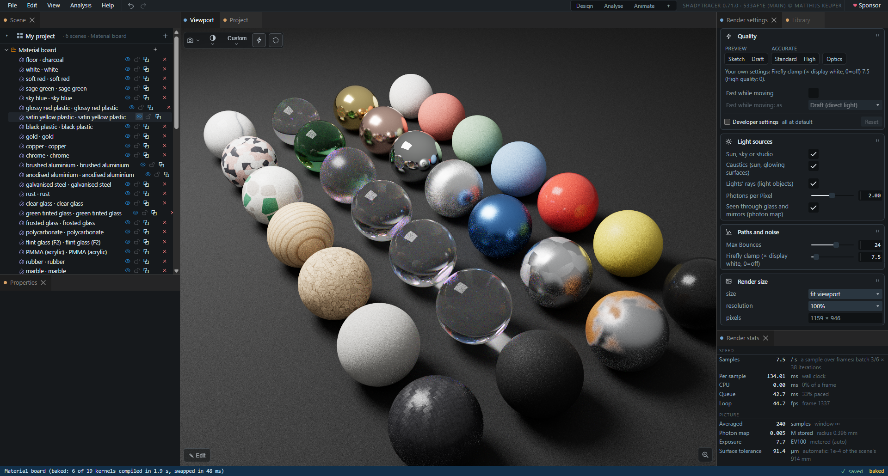
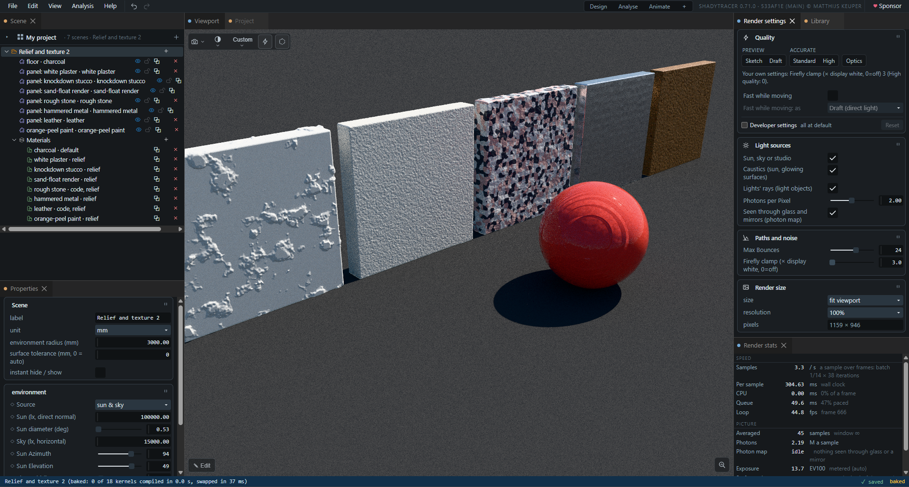
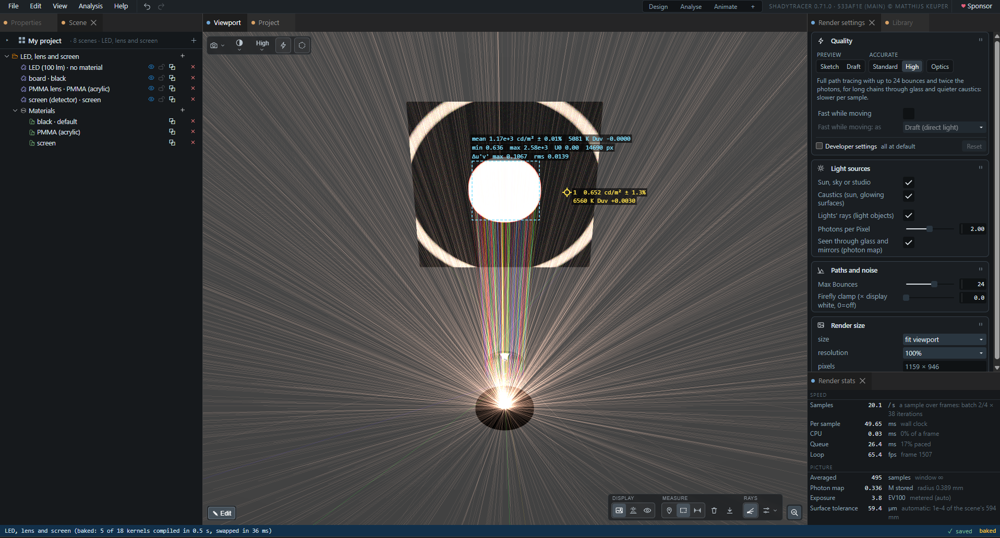
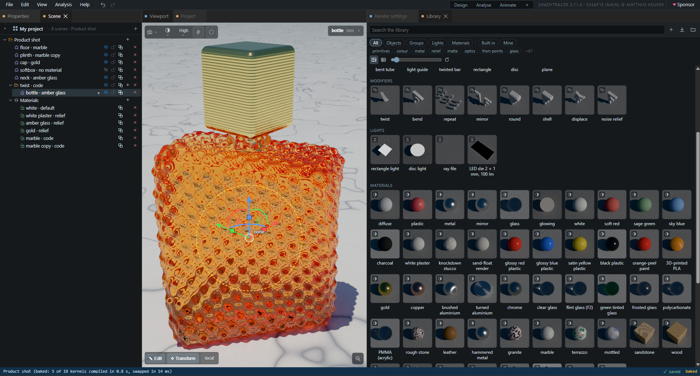
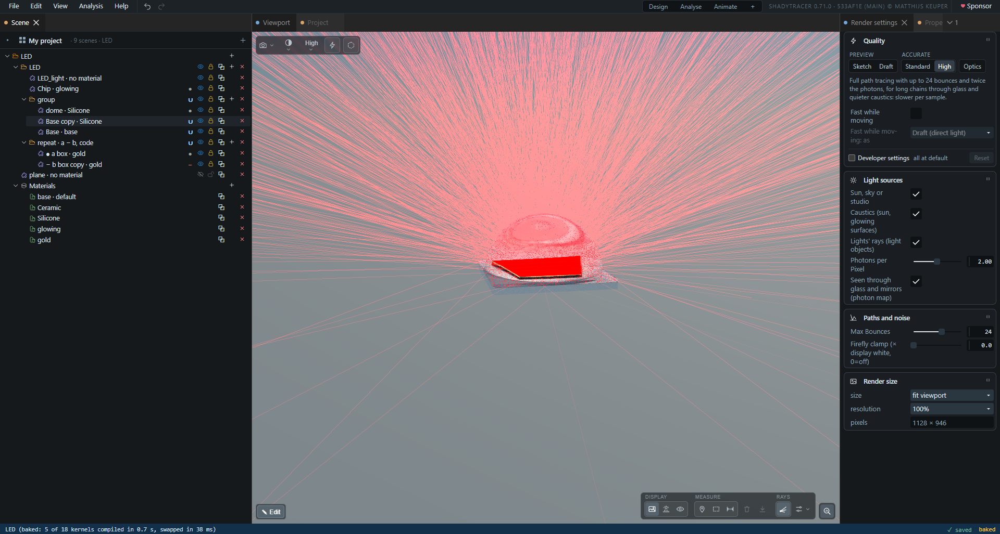
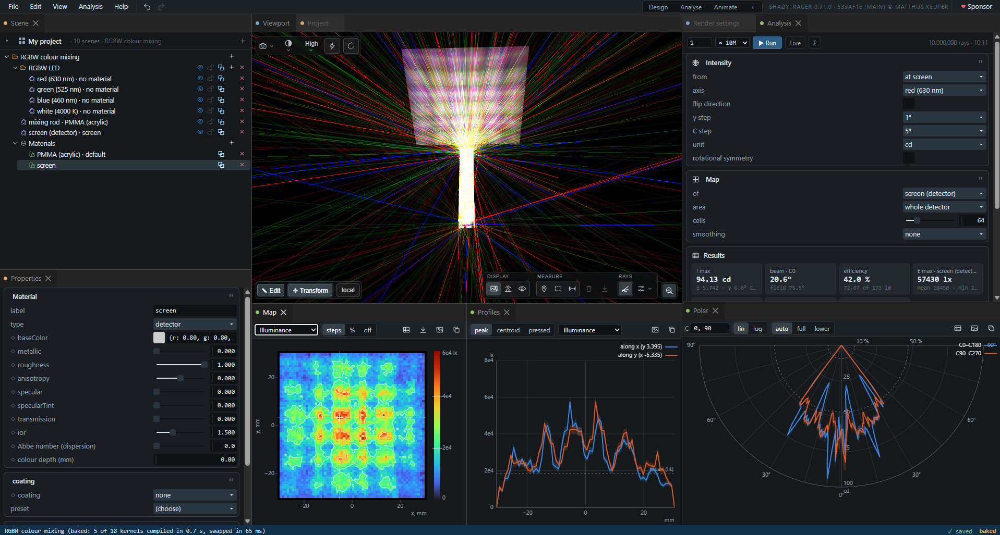
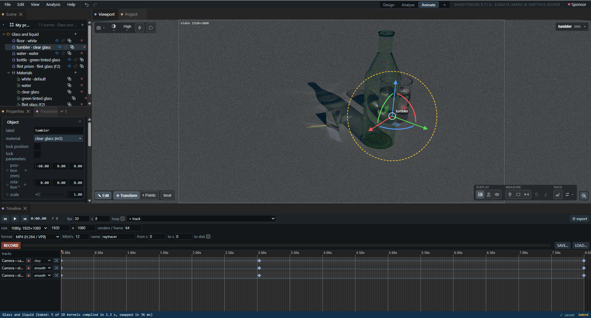

# ShadyTracer

**Physically based light in the browser.** A WebGPU path tracer that renders in real units,
candela per square metre and lux, with a scene builder, a measuring tool, and an optics bench for
LED and luminaire design that traces the same scene the picture shows.

Nothing to install and no server. The page runs on your own graphics card.

**Run it: <https://shadytracer.com>** · Open source, [MIT](LICENSE) ·
[♥ Sponsor](https://github.com/sponsors/lampmaker).


> **In development.** How far along each feature is:
> **✓** checked against a closed-form answer on real hardware ·
> *preview* built and tested without a GPU, not yet confirmed on real hardware ·
> unmarked: in use.
> [`FEATURES.md`](FEATURES.md) is the full ledger, with the evidence for every line.

## Contents

- [Highlights](#highlights)
- [Quick start](#quick-start)
- [The raytracer](#the-raytracer)
  - [The workspace](#the-workspace) · [Rendering](#rendering) · [Light as numbers](#light-as-numbers) ·
    [The scene builder](#the-scene-builder) · [The library](#the-library) ·
    [Optics: the LED and luminaire bench](#optics-the-led-and-luminaire-bench) ·
    [Export for 3D printing](#export-for-3d-printing) · [Animation and video](#animation-and-video) ·
    [Bundled scenes](#bundled-scenes) · [Keyboard and mouse](#keyboard-and-mouse) ·
    [Using the renderer from code](#using-the-renderer-from-code)
- [Checked against known answers](#checked-against-known-answers)
- [What it is built on](#what-it-is-built-on)
- [File formats](#file-formats)
- [Not there yet](#not-there-yet)
- [Repository layout](#repository-layout)
- [Working on the code](#working-on-the-code)
- [Licence and credits](#licence-and-credits)

---

## Highlights

- **Light in physical units.** Luminance in cd/m², illuminance in lux, a sun and sky given by the
  illuminance they deliver. A white floor reads its textbook value to 0.1 % **✓**
- **Caustics through glass**, by tracing photons from the sun and learning where they are worth
  sending **✓**; and what is **seen through glass or in a mirror**, lit right, by a photon map
- **Any glowing surface is a light**, with nothing declared: found by the paths that hit it,
  sampled directly, and sending photons for its own caustics **✓**
- **Dust in the air**: a haze box whose air scatters light in real units, so a beam shows in it;
  it loses no light, to 0.02 % **✓**
- **Glass the way glass behaves**: dispersion that splits white light in a prism, dichroic and
  anti-reflection coatings, colour that deepens with thickness; and a **camera lens** with depth of
  field *preview*
- **Lux and luminance as false colour**, with an **error bar on every pixel**, and a measure tool
  that reads lux, uniformity and colour temperature off any surface *preview*
- **A scene builder where every shape is code** you can edit, with compile errors shown at your own
  line and column, move handles in the picture, CSG, modifiers and undo
- **An optics bench over the same scene**: LEDs, lenses, detectors; refraction and Fresnel
  **✓**; far field in candela with beam and field angles, illuminance maps in lux, CCT and Duv
  *preview*
- **Zemax ray files** as light sources *preview*
- **STEP and STL parts imported as shapes**: each solid in the file becomes boxes, cylinders, cones,
  spheres, tori and rounded prisms joined by union and subtract, exact, with analytic normals; a
  spherical lens from STEP is its two spheres *preview*
- **3MF with colour** for multi-colour 3D printing, straight from the scene *preview*
- **A docking workspace**: pop-out windows for a second monitor, a command palette, every setting by
  name
- **Keyframe any setting and render it to MP4 or GIF**
- **Help inside the program** (F1), and a [tutorial](tutorial/index.html) on how the renderer works

---

## Quick start

Open **<https://shadytracer.com>** in a browser with WebGPU. Or run it from a clone:

```sh
git clone --recursive https://github.com/lampmaker/ShadyTracer.git
cd ShadyTracer
python3 -m http.server 8000
```

Then open <http://localhost:8000/>. `--recursive` matters: TinyWebGPU and GUISTUFF (the property
table and the tree view) are git submodules, and without them the page does not start
(`git submodule update --init` mends a clone made without it).

**What it needs:**
- A browser with **WebGPU**. TinyWebGPU's README gives Chrome/Edge 113+, Firefox 141+ on Windows,
  Safari 26+. The benchmark's runs were made in Chrome 154 on Windows and the dichroics run in
  Chrome 155; the other results do not record a browser.
- A **real graphics card**. The results here are from NVIDIA cards: Pascal (the benchmark names a
  GTX 1080 Ti) and Ampere. A software adapter is for tests only.
- The pages served over **http**: opening the file directly (`file://`) does not work, because
  WebGPU needs a secure context, and `localhost` counts as one.
- No build step, no dependencies, no network once loaded. Every library is in the repository or
  one of its two submodules.

**First steps in the raytracer.** A first visit starts on the *First steps* example; after that, on your own
project, as you left it -- it is kept in the browser as it changes. Over the **Scene** tree a card
for each scene of the project: ▶ or a double-click opens one. The project's name there opens the
**Project** panel: your projects, and the examples to add a copy of. Select an object in the picture and drag its handles;
change its material in **Properties**; switch the view to **lux on surfaces** with the icons in the
drawer at the picture's bottom right; press **Ctrl K** and type what you are looking for, or **F1**
for the help.

---

## The raytracer

### The workspace

- **A menu bar, a dock of panels and a status bar.** Fourteen panels, and one more for each optics
  chart you open. Every panel can be dragged, stacked, floated, maximised, closed, or **popped out
  into a window of its own**, for a second monitor *preview*; the picture stays in the main window.
- **Three layouts**: *Design* (the tree and properties on one side of the picture; Render settings,
  the library and Render stats on the other; the Analysis pane a tab that Analysis › Analysis setup
  shows and hides), *Analyse* (the optics charts) and *Animate* (the timeline). Save your own named
  layouts; the last one comes back on the next visit *preview*.
- **Command palette** (Ctrl K or Ctrl Shift P). It finds every command and every setting, and
  `exposure = 2` sets one *preview*.
- **Parameters panel**: every renderer and scene setting with its value and unit, typed exactly; ⌖
  jumps to its control; right-click copies its path for a script *preview*.
- **Help** (F1, or Help › Contents): a welcome, two tracks (*modelling and rendering*, ten pages;
  *optical design*, eight) and five reference pages made from the program's own lists, with an
  explainer of distance fields whose ray and sliders you can drag. Search; links that open an
  example, run a command or point at a panel *preview*.
- **Render stats**: samples a second and where a frame's time goes, the samples averaged, the photon
  map's state, the exposure and the surface tolerance in force.
- The status bar shows progress for compiles, library pictures and video, whether the project is
  saved, and whether the scene shown is baked (below). **Help › Report** copies a diagnostic report
  of the picture's light and the page's files, and files the browser has cached stale are found and
  reloaded at start-up.

### Rendering



**How light is found**

- **Wavefront path tracing on the GPU.** Rays live in GPU buffers; a march kernel advances them, a
  shade kernel bounces them, and GPU-side counters drive indirect dispatch, so the CPU never waits
  to learn how many rays are alive.
- **Next-event estimation with multiple importance sampling** toward the sun and the sky: 3.8× less
  noise, unbiased **✓**
- **Light tracing for caustics.** Photons from the sun go through glass and off mirrors and connect
  to the camera where they land. Where photons are worth sending is **learned**, on a 128 × 128 map.
  Unbiased to 0.03 %; in the caustic, equal noise about 40× sooner than without it **✓**
- **Glowing surfaces are lights, with nothing declared.** Paths that hit them record where they
  are; the renderer then samples them directly, with multiple importance sampling, and sends
  photons from them for their own caustics. Every check within 0.31 % **✓**; a light and the same
  surface made a glowing object give the same picture **✓**
- **Seen through glass and in mirrors: a photon map.** Light tracing joins a photon to the camera
  with a straight line, which cannot pass through glass or bounce off a mirror. So photons are also
  stored where they land past glass or off a mirror, and gathered by the
  camera's own rays that reach that surface the same way, within a radius that shrinks every sample.
  A floor through a window and a caustic in a mirror are lit as they should be. On by default
  (Light sources › *Seen through glass and mirrors*), and idle when nothing in view is seen that way.
- **Dust in the air: a haze box.** The air inside one box scatters light: a mean free path in
  metres, a colour, and how far forward it scatters (Henyey–Greenstein g). Beams show in it, lit by
  light sampling and by photons; glass and water inside the box stay clear. Its values change live.
  Albedo-1 dust loses no light: within 0.024 % with next-event estimation, 0.002 % without **✓**
- Russian roulette, unbiased **✓**
- **Signed-distance scenes**: every surface is exact distance code, so a sphere is a sphere at any
  zoom, and there are no meshes to tessellate.

**Quality and speed**

- **Five presets**, on the Render settings panel and the view's toolbar: *Sketch* (a flat light, no
  shadows), *Draft* (the direct light at the first diffuse surface; glass and mirrors still
  followed), *Standard*, *High* (up to 24 bounces and twice the photons), and *Optics*, which traces
  the lights' rays through lenses and mirrors to the first diffuse surface, where its floor reads the
  closed form to within 0.6 % **✓**. *Lamps only* lights the view by the scene's own lights and
  glowing objects, the sun and sky off. Sketch and Draft *preview*.
- **Max Diffuse Bounces**, beside Max Bounces: a cap on the bounces off matte and glossy surfaces
  and dust only, so mirrors and glass are still followed; at 0 the picture is the direct light,
  through lenses and mirrors too. And a **Dispersion** switch, for the picture only *preview*.
- **⚡ Fast while moving**: Draft or Sketch while the camera, a handle or a value moves, the full
  picture again when it stops *preview*.
- **The bake**: once your edits stand still, the scene is compiled again with its values as
  constants and swapped in, quicker to render; the status bar says *baked*. A value flagged
  animated stays live in it.
- **Heavy scenes stay responsive**: a slow sample is spread over several frames *preview*.
- **Renders of any size without tiling**: the ray budget is capped by memory, and a larger image
  simply takes more samples to cover *preview*.
- **Bounding boxes measured on the GPU**, far objects skipped: the heaviest bundled scene takes
  3.95× less GPU time per sample with them (measured, Ampere).
- Shader compiles run off the main thread, so a heavy scene does not freeze the page.

**Materials**

- **One layered model for everything**: GGX microfacets sampled by their visible normals, exact
  dielectric Fresnel from the index of refraction, Kulla–Conty energy coupling between the coat and
  the base, and multiple-scattering metal. Energy is conserved to 0.04 % (the white furnace test)
  **✓**, and sampling agrees with evaluation **✓**
- Presets: **diffuse, plastic, metal, mirror, glass, glowing**.
- **Glass in colour, and in colours** *preview*: a **colour depth** absorbs through the glass's
  thickness (Beer–Lambert); an **Abbe number** disperses it, so a prism splits white light; **thin-film
  coatings** (dichroic, beam splitter, anti-reflection) reflect by wavelength and angle, averaged
  per colour channel.
- **Anisotropic surfaces along a grain** (brushed, turned, radial) **✓**; visible brush streaks
  *preview*.
- **Any material field can be code**: checkers, stripes and brushed grain ship as examples.
- **A noise library for surfaces**: value, gradient, fBm and Worley noise, each with its analytic
  gradient and a proved or measured bound on its slope, so a displaced surface never lets the march
  step through it *preview*.
- Rough (frosted) glass works; its furnace reading (0.944) is still an open question.



**Light in physical units** **✓**

- **Luminance in cd/m², illuminance in lux**, everywhere. A white floor under sun and sky reads ρE/π
  to 0.1 %, under every light and every sampling strategy **✓**
- **The sun** is its direct normal illuminance (default 100 000 lx) at its real angular size
  (0.53°), so a bigger sun makes softer shadows, not a brighter picture. **The sky** is the
  illuminance it puts on the ground (default 15 000 lx), shaped by a Rayleigh and Mie scattering
  model and normalised on the GPU. Turbidity **✓**
- **A studio light**: a set illuminance, a share from above and a tint *preview*.
- **Glowing materials** in cd/m².
- **Scene units** m, cm or mm; every numerical tolerance follows the scene's size, so a 5 cm lens
  and a room both work *preview*.
- **Colours outside the display's gamut are kept exactly** and clipped once, at the display: three
  LEDs mixed to 4000 K read 3999.9 K **✓**

**The picture**

- **Exposure in EV100**, metered on the GPU with highlight protection, eased so it does not shimmer;
  compensation; meter and lock.
- **Seven tone curves**: clip, PBR Neutral (the default), AgX, AgX punchy, ACES, Reinhard, Hable.
- **Save a PNG** up to 16 384 px on a side (or what the graphics card allows) with up to 16 384
  samples; abortable *preview*. The render is kept as light, so its exposure, tone curve and grading
  are chosen on a preview afterwards, and saved as often as wanted, each file named with the time it
  was saved.
- Perspective or orthographic camera, orbit or walk, and a **lens**: an aperture and a focus
  distance, for depth of field *preview*. Each scene keeps its own camera and exposure.

### Light as numbers



- **Three views**, one icon each in the drawer at the picture's bottom right: **photographic**; **lux
  on surfaces**, every visible surface's illuminance whatever its material; **luminance in cd/m²**,
  the picture itself as numbers. Both measuring views draw a logarithmic false colour with bands and
  a legend *preview*.
- **An error bar on every pixel.** The cursor reads cd/m² or lux ± %, and how many samples'
  worth that is *preview*.
- **The measure tool** *preview*:
  - **Pins** that stick to the surface you click and re-read as the picture converges;
  - an **area**: its mean ± error, minimum, maximum and uniformity **U0**;
  - each reading's **colour** as CCT + Duv, or CIE xy away from white, and an area's Δu′v′ spread;
  - a **ruler**: points on surfaces with their x, y, z, the distances between them, and each
    stretch's steps in x, y and z drawn in red, green and blue; a drag moves a point, or turns the
    view;
  - **CSV** of everything.

### The scene builder


- **Projects of several scenes**, each with its environment, its objects in groups, its materials,
  and its own camera, exposure, surface tolerance and timeline. Over the tree, one line for the
  project and a card per scene, with its last picture
  and how long it took to open: a click shows it in Properties, ▶ or a double-click opens it (a
  compile), its ⋯ duplicates, exports or deletes it, a drag reorders, and a tree row dropped on it
  is copied there (Shift: moved). The tree shows the scene being worked on, its row the root.
  Undoing a change to the list of scenes stays on the scene being worked on.
- **Projects kept in the browser**, saved as they change -- there is no Save: a reload comes back to
  the same scene, camera and settings. The **Project** panel (the project's name, or File ›
  Projects…) lists them (open, new, rename, duplicate, download, delete), this project's scenes and
  the examples. **File** is five rows: New project, Projects…, Import from file…, Export ▸ (a scene,
  the project, a 3D print), Save picture…. A second tab on a project works on its own copy.
- **Import STEP and STL** (File › Import from file…, or drop the file on the page): each solid in
  the file becomes a group of the builder's own shapes -- boxes, cylinders, cones, spheres, tori and
  rounded prisms joined by union, intersect and subtract -- converted exactly from the faces'
  surfaces, an STL's fitted back from its facets first; editable like anything built by hand. It
  stands on the floor, its axes the file's. A freeform (B-spline)
  face, a mesh that is not closed or a scan is refused by name, with why
  ([`roadmap/IMPORT.md`](roadmap/IMPORT.md) section 11) *preview*
- **Twenty-six shapes in three groups**, each an editable piece of code from the start:
  - *Primitives:* sphere, box, cylinder, capsule, torus, cone, round cone, **pyramid** (a rectangular
    base and top: an apex or a frustum), **prism** (its number of sides a live slider), octahedron,
    capped torus, link, tube, **dome** (standing on its base), plane;
  - *Optics:* **lens** (diameter, thickness, two signed radii), **aspheric lens** (a radius, a conic
    constant and a4 to a10 on each face, typed from a datasheet), **Fresnel lens**, **parabolic
    reflector** (its focus at its origin), rectangle and disc (detectors, limiters);
  - *From points:* extrusion, revolution, **bent tube**, **light guide**, **twisted bar**; or a blank
    one *preview*.
- **Lights, a haze box and an export box** are nodes in the tree too, placed and stretched with the
  same handles.
- **Shapes from points**: a profile parameter is an outline, one point a line -- `x, y`, and a fillet
  radius to round that corner -- which a node's code extrudes or revolves; a **path** parameter is an open
  line, `x, y, z` and a fillet a point, which it sweeps a tube or a profile along, and a point can scale
  and twist the section there *preview*. A path's or a profile's points can name the object's
  parameters (`0.5, 0.5, rise`), and a **live** one moves with their sliders without a recompile;
  untick live once it is right (paths confirmed; profiles *preview*).
- **Booleans per child**: each child of a group joins by union, subtract or intersect, with a smooth
  blend; the tree marks each join, and a group's joins can be typed as a recipe. A subtraction's walls
  wear the cutter's material.
- **A group as a component**: its parameters drive what is inside it, *from parameters* -- a child's
  sizes, its place, a blend, a row of copies, and a light's flux and colour (`light.flux = flux`)
  *preview*.
- **Nine modifiers**, groups whose code bends what is inside them: twist, bend, repeat, mirror,
  **circular array** (copies round an axis: apart, or merged into one shape where they overlap),
  round, shell, displace, **noise relief** *preview*.
- **Write any object, group or material in WGSL.** Give it parameters (a number, a vector or a
  colour; live, or baked into the shader; with a range; a length in the scene's unit). A probe
  compile runs half a second after you stop typing and shows errors **at your own line and
  column**.
- **Most edits are instant**: parameters, positions, blends and material values are uniforms, so
  moving a slider never recompiles. Structure changes recompile, off the main thread.
- **Edit in the picture**: click to select (Shift-click goes one level deeper, double-click to the
  deepest). One **Transform** gizmo: arrows, planes, a ring and rotation arcs to move and turn, a
  **cube on each of the shape's own axes** to stretch its own sizes, a circle to scale; local or world
  axes; Ctrl snaps to the grid. A **Points** mode drags a path's or a profile's points in the picture.
  A panel at the view's top right shows the selection's position, rotation, scale and sizes, and
  what a drag changes. **Lock** a node's position or its parameters against the hand.
- **Undo and redo** across the whole project, 100 steps *preview*; **copy, paste, duplicate**
  *preview*; **hide and show** without recompiling *preview*.
- **Four material types**: surface, glowing, **optics detector**, **ray limiter** (seen by the
  optics trace, invisible in the picture).
- **Files**: **Export ▸** a scene, the project (every scene with its view, and the render settings),
  or a 3D print. **Import from file…** (Ctrl O, or drop a file on the page): a scene joins the
  project; a project file asks whether to open as a project of its own or add its scenes to this
  one. Every older file format is upgraded on load. A file with problems is refused and nothing
  changes: the status bar names the first problem, the console lists them all.

### The library



- **43 built-in items**: the 26 shapes, 8 modifiers, 3 lights and 6 material presets; **42 named
  materials**: plastics and paints, plaster, stucco and render, metals plain, brushed, turned,
  anodised, galvanised and hammered, clear, tinted, frosted and flint glass, PMMA and
  polycarbonate, stone, marble and granite, wood, cork, leather, rubber, concrete, rust and more;
  **four optics parts** (a PMMA lens Ø 18 mm, an LED die 2 × 1 mm at 100 lm, a detector screen, and a
  whole LED–lens–screen bench) *preview*.
- **Every item is a rendered picture**, made by a second, hidden path tracer while the main view is
  idle, and kept; rest the pointer on one to see it rendered live *preview*.
- **Drag items onto the tree or into the picture**: a material onto the object under the pointer, a
  shape standing on the surface where you drop it, units converted *preview*.
- **Keep your own**: the selection becomes an item; rename, remove, export and import them as a file
  *preview*.
- Search by name, category, tag or help text; filter by kind, built-in or your own, and tag; grid or
  list *preview*.

### Optics: the LED and luminaire bench



A **non-sequential Monte Carlo trace** over the same scene, geometry and materials the picture uses,
so the numbers and the picture cannot disagree (the dust of a haze box is the one thing it leaves
out, and says so). Rays are weighted, never discarded; every lumen is
booked (emitted = escaped + lost + absorbed, to zero); a run is split into batches, so **every
number carries its standard error**.

**Sources** *preview*
- **Rectangle and disc lights** as objects in the scene, as many as you like, placed with the
  handles; and **Zemax ray files** (below).
- **Distribution**: Lambertian or cosⁿ, uniform cone, collimated; any of them limited to a cone.
- **Amount** as flux in **lumens** or luminance in **cd/m²**; the other is derived.
- **Colour** as RGB, **CCT + Duv**, or **CIE xy**, carried exactly, even outside the display's
  gamut **✓**
- **Transparent or opaque, one- or two-sided, and the index it emits into**, so an LED die can sit
  inside its silicone.
- **The optics sources light the rendered picture at their real brightness**: a lens's spot on a
  screen shows in lux **✓**

**Zemax ray files** *preview*
- Reads Zemax OpticStudio binary source files (`.DAT`): flux-only and spectral records, any of
  their units, the file's own placement; a malformed file is refused with the numbers.
- Placed with the handles; kept in the browser by name, so a reload keeps it.

**The trace**
- **Refraction, Fresnel and total internal reflection**: a slab at three angles, a glass ball and a
  wedge match the textbook within two standard errors; the wedge's exit angle to 2 × 10⁻⁶ ° **✓**
- **Coatings and dispersion** as in the picture: a dichroic sends one band one way and the rest the
  other, a prism fans white light into its colours *preview*.
- **Detectors** stop and record every ray that reaches them; **ray limiters** do the same but are
  invisible in the picture, for a cross-section of a beam *preview*.
- **Totals**: emitted, escaped, absorbed, on detectors, lost, and per object and per material what
  arrives and what is absorbed, each ± its error *preview*.
- **See the rays**: up to 20 000 rays drawn over the picture and retraced live while you move
  things, coloured by the flux left, by step, plainly, by the light's own colour, or by colour ×
  flux; an **optical path length slider** sweeps the light through the system as a front *preview*.
- **Live**: the analysis run again and again while you edit, every chart, card and total following;
  with **Σ**, its rounds add up while nothing changes. A run is a number of rays times × 1 to × 10M,
  up to 50 million.



**Far field: luminous intensity** *preview*
- A **type C (C, γ) grid**, fed by the rays that escape or by one detector, from 0.25° steps.
- **Intensity in cd or cd/klm**, an error bar per bin, rotational symmetry pooled if you ask.
- **Beam angle (50 %) and field angle (10 %)** per plane, **I max**, **optical efficiency**, **zonal
  flux** (0–30°, 0–60°, 0–90°, 90–180°).
- A **polar diagram** (up to nine C planes, linear or logarithmic, ±1 standard-error band) and
  **intensity against angle**, zooming itself to narrow beams.

**Illuminance: detector maps** *preview*
- An **illuminance map in lux** on a detector, 8 to 256 cells, zoomed by Shift-dragging. Hold the button
  down and move: the value under the pointer is read, and the profiles follow it.
- **More than one of any chart**, each with its own settings on a strip along its top: an illuminance map
  beside a CCT map, read at the same place.
- **Smoothing**: none, Gaussian, Epanechnikov (both keep the flux exactly), or a photon-map estimate
  from the k nearest hits.
- **E max, mean and min, U0 = min/mean, Ud = min/max**, lit area, noise per cell.
- **Isolux lines**, **profiles** along both axes, a **radial profile**, **encircled flux with r50 and
  r90**.
- A **virtual plane** at any distance, computed from the far field without tracing again.

**Colour** *preview*
- Detectors read the **exact colour** of what arrives: CIE xy, u′v′, **CCT and Duv**; single lights
  exact to 10⁻⁸ **✓**
- **Colour uniformity** Δu′v′ (max and rms); maps of the light's true colour, its colour alone,
  CCT, x, y, Duv, or Δu′v′ from a target.
- **Colour mixing**: pick three of the scene's lights, a target colour and a total flux, and it sets
  their fluxes (one undo step).

**Export**: the intensity table, the illuminance map and the detector hits an analysis kept (up to
500 000) as **CSV**; any chart as **PNG**.

### Export for 3D printing

*preview*
- Put an **export box** around what you want to print, placed with the handles.
- The distance field is sampled on the GPU and meshed into a **closed surface** (marching
  tetrahedra), each triangle coloured from its material and reduced to at most 16 colours.
- Saved as **3MF with colour**, made for Bambu Studio's filament mapping, or as **STL**, in mm.
- Known limits: features thinner than a cell disappear, sharp edges are bevelled by up to a cell,
  and meshes are dense (no decimation yet).

### Animation and video



*preview*
- **Keyframes on any live setting**: the camera, the sun, a light's flux, an object's position. Flag
  a value ◇ as animated and *+ track* offers it; the scene's camera and exposure can be flagged too.
- Linear, smooth, spline or step interpolation, with easing.
- **Each scene its own timeline**, saved in its file: the keys, the frame rate and length, and the video's size and
  samples. The format and bitrate are yours, the same in every scene.
- **Record**: every frame rendered offscreen at the export size with its own samples.
- **MP4** (H.264, or VP9 or AV1 where H.264 is missing; Chromium browsers), a looping **GIF** (256
  colours a frame; any browser), or a **ZIP of PNG frames** (any browser), streamed to disk where the
  browser allows, and named with the time the recording started.

### Bundled scenes

**The Project panel's examples**, by who they are for and what they show; each opens as a copy in your project, with its own camera, exposure and timeline. They are made in code by `scenes/make.mjs`, which says why each size is what it is; the scenes that were the examples before 0.54.0 are test fixtures now (`test/fixtures/scenes/`).

**Modelling and rendering**

| example | group | unit | what it shows |
|---|---|---|---|
| **First steps** | Start | mm | Shapes on a table in daylight: one glass, two blended into one |
| **Shape gallery** | Shapes | mm | Every built-in shape, about 50 mm across |
| **Combining shapes** | Shapes | mm | Union, subtract and intersect, sharp and blended; a die made the way a die is |
| **Modifiers** | Shapes | mm | Twist, bend, repeat, mirror, circular array, round, shell, displace and relief, each on a plain shape |
| **From points** | Shapes | mm | An extruded star, a turned wine glass, a pipe along a path, a swept bar |
| **Parametric part** | Shapes | mm | A heatsink whose fin count, pitch and height are its parameters |
| **Imported parts** | Shapes | mm | STEP and STL parts imported as boxes, cylinders, cones, spheres, tori and rounded prisms |
| **Infinite detail** | Shapes | m | A Menger sponge four levels deep, and columns repeated to the horizon |
| **Material board** | Materials | mm | The library's materials on 40 mm spheres |
| **Relief and texture** | Materials | mm | Plaster, stucco, render, stone, hammered metal, leather: reliefs in a raking light |
| **Glass and liquid** | Materials | mm | A tumbler of water, a green bottle, a flint prism in the sun |
| **Lighting a room** | Light and camera | m | A room in metres: daylight through a window and a 1500 lm lamp |
| **Depth of field** | Light and camera | mm | A row of pawns through an open lens, focused on the third |
| **Animation** | Light and camera | mm | Values marked animated, for the Timeline |
| **Product shot** | Light and camera | mm | A perfume bottle on a plinth in studio light |

**Optical design**

| example | group | unit | what it shows |
|---|---|---|---|
| **LED, lens and screen** | Optical design | mm | An LED, a PMMA lens and a detector: illuminance in lux |
| **Beam in dusty air** | Optical design | mm | An LED's beam through a lens, seen in dust; a PMMA block in it stays clear |
| **Aspheric condenser** | Optical design | mm | An aspheric lens collimating a small source |
| **Fresnel or plano-convex** | Optical design | mm | One focal length made two ways, side by side |
| **Parabolic reflector** | Optical design | mm | A torch's reflector: the far field, intensity and beam angle |
| **Light guide** | Optical design | mm | Light carried round two bends by total internal reflection |
| **RGBW colour mixing** | Optical design | mm | Four LEDs and a mixing rod: the colour map |
| **Dispersion in a prism** | Optical design | mm | White light split by a flint prism at minimum deviation |
| **Dichroic combiner** | Optical design | mm | Red and blue beams joined by a coated plate |
| **Office lighting** | Optical design | m | Four LED panels and the work plane's illuminance |

### Keyboard and mouse

| in the picture | |
|---|---|
| left drag | orbit |
| Ctrl + left drag | roll |
| middle drag | pan |
| wheel | move in and out |
| Ctrl + wheel | zoom (field of view) |
| Shift + wheel | raise and lower |
| W A S D | walk, in the walk camera; in and out, and pan, in the orbit camera |
| Space, Q | up and down |
| arrow keys | turn |
| click | select an object (the top-level one, or within the group you are in) |
| Shift + click, double-click | one level deeper; the deepest |
| double-click a row in the tree | the camera glides to frame that object |
| Esc | up one level; during a drag, cancel it; with a measuring tool on, turn it off |
| Ctrl while dragging a handle | snap: position and size to the grid at the node, 15° in angle, 0.1 in scale |
| Delete, Insert or +, Enter | in the Points mode: remove a point, add one, type its numbers |

| anywhere | |
|---|---|
| Ctrl K, Ctrl Shift P | find a command or a setting |
| Ctrl Z / Ctrl Shift Z or Ctrl Y | undo / redo |
| F1 | the help |
| Ctrl S | save the project in the browser now (it is saved as it changes anyway), or the library item being edited |
| Ctrl O | import a scene or project file |
| Ctrl C / Ctrl V / Ctrl D | copy / paste / duplicate, in the scene tree -- copy and paste through the system clipboard, so also between tabs |
| Ctrl Enter | apply the code you are editing |
| Enter, in the library's search | put in the first match |
| Space, arrow keys, Home, End | play, step a frame, go to the start or the end, in the timeline |
| Delete | delete the selected keys, in the timeline |

### Using the renderer from code

The renderer is a component: a program gives it a WebGPU device, a camera and a scene, and asks for
samples.

```js
import { createPathTracer } from './lib/pathtracer/index.js'

const RT = await createPathTracer({ gpu, ctx, Q, scene, CAMERA, minfps: 20 })
await RT.init()
RT.start()                          // its own loop, or drive it: RT.pause(), then await RT.step(n)
RT.set({ sunIlluminance: 50000 })  // any setting by name; returns the names it did not know
await RT.saveImage({ width: 1920, height: 1080, samples: 512, filename: 'shot.png' })
const hit = await RT.pick(0, 0)     // what is at the centre of the picture
```

A scene is WGSL distance code plus its materials, parameters and resources; see
[`lib/pathtracer/README.md`](lib/pathtracer/README.md). In the raytracer page, `RT`, `BUILDER`,
`OPTICS`, `MEASURE`, `PARAMS`, `LIBRARY`, `TIMELINE`, `SHELL` and `HELP`, among others, are on
`window` for the console.

---

## Checked against known answers

Every number above that carries a **✓** comes from a test with a closed-form answer, run in the page
on a real graphics card: one button each in the **Tests** panel. The results are recorded in
[`docs/TESTING.md`](docs/TESTING.md).

| test | what must hold | result |
|---|---|---|
| `photometry` | a white floor under sun and sky reads ρE/π | 0.9984–1.0001 on ten rows (Pascal) |
| `furnace` | a white sphere in uniform light vanishes | every material 1.000 to 0.04 %; rough glass open |
| `bsdf-parity` | light sampling and material sampling give one answer | agree within the control's noise |
| `nee` | sampling the sun and sky directly is unbiased and quieter | unbiased, 3.8× less noise with sun and sky (partly answered: TESTING.md) |
| `lt` | light tracing moves the noise and never the mean | within 0.03 % (Ampere) |
| `emitters` | glowing surfaces as lights hold the mean | within 0.31 % (Pascal) |
| `rr-bias` | Russian roulette | unbiased |
| `light-vs-emitter` | a light and the same surface made a glowing object give one picture, over diffuse, mirror and metal floors, through glass, in Draft and Optics | every pair 1, five presses (Ampere) |
| `haze` | albedo-1 dust in the air loses no light | within 0.024 % with next-event estimation, 0.002 % without (Pascal) |
| `optics-mode` | the Optics view lights a floor as arithmetic says | 0.994–0.999 of the direct light's closed form (Ampere) |
| `optics-refraction` | a slab at 0, 45, 70°; total internal reflection; a ball; a wedge | within two standard errors; the wedge to 2 × 10⁻⁶ °; the books balance to zero (Pascal, 400 000 rays a row) |
| `optics-colour` | a detector reads the colour a light was given | single lights to 10⁻⁸ (Pascal) |
| `optics-light` | an optics source lights the picture at its real brightness | lux within the error bars; three LEDs mixed to 4000 K read 3999.9 K (Pascal) |

Built and waiting for their first run: `error-bar`, `illuminance`, `cosine-law`, `disc-light`,
`scale`, `render-modes`, `draft-lamps`, `small-caustic`, `small-emitter`, `sppm`, `optics-balance`,
`optics-farfield`, `optics-absorption`, `optics-coating`, `optics-dispersion`.

Without a GPU, **`check-shaders`** builds every kernel against every scene (6358 builds) and checks
each one, and 136 test files -- 104 in Node, 17 in headless Chromium, 15 on a WebGPU in Node over a
software adapter -- cover the light units, the error bars, the colour science, the noise, the photon
map, the haze, the lens, dispersion and coatings, the optics statistics and charts, the Zemax
reader, the builder, the mesher and 3MF writer, the library, the projects kept in the browser, the
timeline, the shell, the help and the tutorial. The list is in
[`CLAUDE.md`](CLAUDE.md).

---

## What it is built on

- **[TinyWebGPU](https://github.com/lampmaker/tinywebgpu)** (`lib/tinywebgpu/`, a submodule): a
  single-file WebGPU framework with no build step. A plain object becomes the WGSL uniform struct,
  the binding layout and the buffer offsets; compute and render pipelines, async compiles and a
  pipeline cache, indirect dispatch, frame batching, texture upload. MIT.
- **`lib/shell/`**: the application shell: menu bar, docking (on the vendored dockview), layouts,
  command palette, a parameter registry.
- **`lib/timeline/`**: keyframes, a sequencer, the editor, an offscreen recorder, MP4, GIF and
  PNG-ZIP encoders.
- **[GUISTUFF](https://github.com/lampmaker/GUISTUFF)** (`lib/guistuff/`, a submodule): the
  property table, tree view and split pane, on Tweakpane. MIT.
- **`lib/render-loop.js`**, **`lib/render-cost.js`**, **`lib/camera.js`**: the opt-in frame loop,
  the frame-cost meter, the orbit and walk camera.

---

## File formats

| reads | writes |
|---|---|
| scenes, projects and workspaces (`.json`, every past version; scenes are at version 22) | scenes, projects and workspaces (`.json`) |
| Zemax ray files (`.DAT`) | pictures (**PNG**); video (**MP4**, **GIF**, or a ZIP of PNG frames) |
| **STEP** (`.step`, `.stp`) and **STL**: solids, converted into shapes | |
| library files (`.json`) and timeline files (`.timeline.json`) | **3MF with colour**, **STL** |
| | **CSV**: measurements, intensity table, illuminance map, detector hits; charts as PNG |
| | library files (`.json`) and timeline files (`.timeline.json`) |

A saved picture, chart or video is named with the local time it was saved, so a folder of them sorts
in the order they were made.

---

## Not there yet

Planned, in the order the plans give, with more in [`FEATURES.md`](FEATURES.md) and
[`roadmap/PLAN.md`](roadmap/PLAN.md):

- **A tolerance per pixel**, following how far the camera is from what it sees, so a close look at a
  small part of a large scene stays exact: designed, the next to be built.
- **Glowing objects as optics sources**, with **"set lumens"**; then **IES and EULUMDAT export**, then
  import as a source.
- A reflectance for an LED's own face, thin air gaps, a stratified choice of source.
- **Point sensors and work-plane grids** in the renderer; the rest of a **realistic camera**:
  f-number, shutter, ISO and sensor size (the lens and its depth of field are in).
- An isocandela map; a pinned reference run and a datasheet overlay under the charts.
- **A wavelength per ray** for the optics analysis, from a source's own spectrum, and **polarisation**,
  when a design needs them. Dispersion and coatings are in, averaged per colour channel.
- **More of the dust**: a volume photon map, scattering inside materials, beams in the Optics view.
  Until then Draft scatters once, Sketch and the Optics view leave the dust out, light scattered in
  dust is seen through glass only by the camera's own paths, and the optics bench does not trace it.
- **More surfaces**: weathering (patches, edge wear, dust cover, wet), bump that conserves energy,
  sheen, a clear coat over anything, interference films (tarnish, anodised titanium), hair.
- A guided tour in the help; a study panel with parameter sweeps and an optimiser.

- **More of import**: freeform (B-spline) faces and scans, through a distance grid; recognising the
  patterns CAD makes most (a rounded box, a tube, a lens) as one shape; colours from STEP; OBJ, PLY
  and 3MF ([`roadmap/IMPORT.md`](roadmap/IMPORT.md) section 11.5).

And not planned yet, but asked of a tool like this: UGR and other glare metrics, CRI and TM-30.

---

## Repository layout

```
index.html            the application (served as is: GitHub Pages serves this folder)
builder/ library/ optics/ tools/ workspace/ scenes/ bench/   ...and its modules
help/                 the in-app help: its pages, the reference made from the program, its widgets
test/                 the application's own tests (each module folder has its test/ too)
roadmap/              the plans: where things stand (PLAN.md), the architecture, the builder, surfaces,
                      dust and other media, UI, analytics, import
docs/                 the test bench (TESTING.md), the measured performance (PERFORMANCE.md) and its
                      review, and
  screenshots/        the pictures in this README, and how each was taken
tutorial/             ShadyTracer, inside out: how the renderer works, chapter by chapter, with live figures
ui-mockups/           the interface's mockups, the designs it was chosen from
lib/                  shared, project-agnostic — see lib/README.md before adding anything
  pathtracer/         the renderer as a component; optics/ and measure/ inside it
  shell/ timeline/ dockview/   the application shell and its vendored libraries
  tinywebgpu/ guistuff/        git submodules: lampmaker/tinywebgpu and lampmaker/GUISTUFF
FEATURES.md           every feature with its status and evidence
CHANGELOG.md          what each version changed, and what to look at; the version is in version.js
CLAUDE.md             the rules for working on this repository, and every check that runs without a GPU
LICENSE               MIT; THIRD_PARTY.md lists what is someone else's
```

---

## Working on the code

Working on this with an agent? **[`CLAUDE.md`](CLAUDE.md)** holds the rules and what can be verified
without a GPU; **[`roadmap/PLAN.md`](roadmap/PLAN.md)** holds where the path
tracer actually stands, including the parts that are finished but unproven. For the renderer,
[`lib/pathtracer/README.md`](lib/pathtracer/README.md) is the real orientation.

**[`tutorial/`](tutorial/index.html)** explains the renderer from zero, for developers new to ray tracing:
rays, distance fields, light, noise and every trick for speed, each with live figures and the real code
beside it. Its 34 chapters, in ten parts, are written as drafts and being read by new readers and revised;
[`tutorial/PLAN.md`](tutorial/PLAN.md) has its contents and where it stands. It quotes the code, so every
change to ShadyTracer reviews the tutorial in the same pull request (`node tutorial/review/affected.mjs`
lists the chapters a branch touches; CLAUDE.md has the steps).

### Versions

The application's version is in `version.js`, and what each version changed is in
[`CHANGELOG.md`](CHANGELOG.md). The page shows the version with the
git revision it was served from, in its title, About, the report and every test result.

Pull requests merge into `dev`, each with a change note in `changes/`. A release (`node release.mjs`, or VS
Code's *Release dev → main* task) turns the notes into the next version and pushes `dev` to `main`, which is what
GitHub Pages serves. CLAUDE.md's *Versions* section has the rule.

### Measuring

The renderer cannot be measured usefully on a software adapter, so it carries an in-page bench that
runs on whatever card the page is open on: the **Tests** panel, one button per measurement,
reporting into a popup you can copy out of, plus a benchmark with a fixed scene and camera. See
`docs/TESTING.md` for what the tests decide and how to add one, and
`docs/PERFORMANCE.md` for the benchmark's runs.

### Shared code

`lib/` holds the code that knows nothing about this application. Two parts of it are other
repositories, held as git submodules pinned to a commit, and are changed there, never here:

| | |
|---|---|
| `lib/tinywebgpu/` | [lampmaker/tinywebgpu](https://github.com/lampmaker/tinywebgpu): pipelines, uniform packing, buffers, textures, frame batching |
| `lib/guistuff/` | [lampmaker/GUISTUFF](https://github.com/lampmaker/GUISTUFF): property table, split pane, tree view, and Tweakpane inside `propertytable/` |
| `lib/wgsl_shorthand.js` | optional WGSL token expander (`FLOAT` → `f32`, …) for `G.defines` |
| `lib/timeline/` | keyframe timeline, sequencer and video exporter (MP4, GIF, or a ZIP of PNG frames). A **vendored copy**: canonical home is `CODE_WOOD/LIBRARIES/TIMELINE`, refreshed with `node lib/timeline/sync.mjs`. |
| `lib/filename.js` | a saved file's name with the local time it was saved |
| `lib/camera.js`, `lib/utils.js` | orbit and walk camera with its lens, and misc helpers |

Both submodules were once copies inside this code, and both drifted ahead of their own
repositories. `lib/README.md` says why that matters and how a pin is moved.

### Continuous integration

`.github/workflows/test.yml` runs `check-shaders.mjs` and every Node test on each push and pull
request. `.github/workflows/pages.yml` publishes `main` to GitHub Pages, with the commit it deployed
in a `REVISION` file so the page can name its build there too.

---

## Licence and credits

© Matthijs Keuper. **MIT licence**: see [`LICENSE`](LICENSE). TinyWebGPU and GUISTUFF are separate
repositories, also MIT. What in this repository is someone else's, and under which licence, is in
[`THIRD_PARTY.md`](THIRD_PARTY.md).

ShadyTracer is free and stays free. If it is useful to you, a tip, one-time or monthly, through
[GitHub Sponsors](https://github.com/sponsors/lampmaker) keeps it going. The app has the same link at the
right end of its menu bar, and under Help › Support ShadyTracer….

Built on, with thanks, all under the MIT licence:
[dockview](https://github.com/dockview/dockview) 8.3.1 (docking),
[Tweakpane](https://github.com/cocopon/tweakpane) 4.0.4, modified (controls),
[mp4-muxer](https://github.com/Vanilagy/mp4-muxer) 5.2.1 (video), and
[Heroicons](https://heroicons.com/) (icons in the tree view). Distance functions after
[Inigo Quilez](https://iquilezles.org/articles/distfunctions/).
